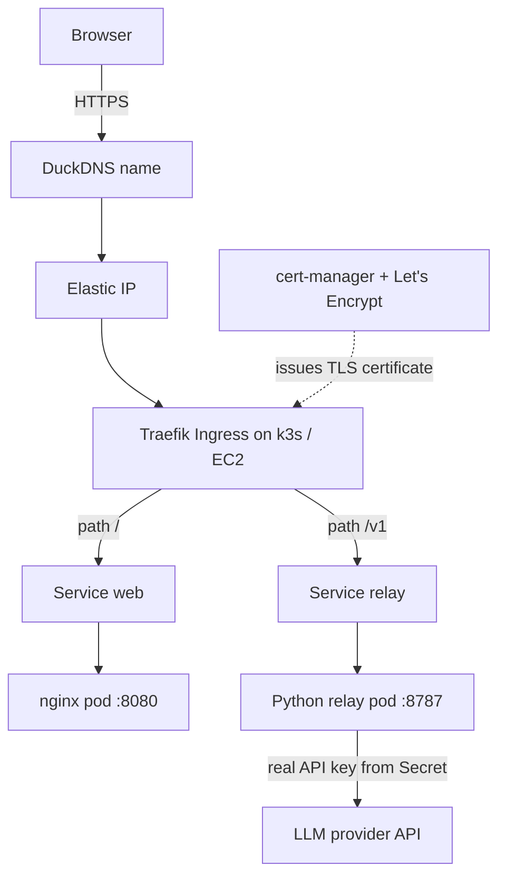

# Resume Tailor on Kubernetes (AWS)

**Resume Tailor** is a browser-based tool I built, with Claude (Anthropic) as an AI coding assistant, that uses an LLM to tailor a resume to a job description. This repository contains the app and its **production-style deployment on Kubernetes and AWS**: a hardened API relay, automatic HTTPS, autoscaling, network policies and CI.

The app itself is a static HTML/JS tool. Most of this repository is the **platform layer** around it: containers, a secure proxy, Kubernetes manifests, TLS, and delivery.

> **Live site:** https://titu-resume-retailor.duckdns.org
> **Status:** always-on on **k3s (EC2)**. **Amazon EKS** was deployed as a short-lived demo with the same manifests, then deleted to control cost.


---

## Table of contents

- [Why this project exists](#why-this-project-exists)
- [Architecture](#architecture)
- [Tech stack](#tech-stack)
- [Repository structure](#repository-structure)
- [Security design](#security-design)
- [Prerequisites](#prerequisites)
- [Quick start: run locally with Docker](#quick-start-run-locally-with-docker)
- [Build and push images to ECR Public](#build-and-push-images-to-ecr-public)
- [Deploy to k3s on EC2](#deploy-to-k3s-on-ec2)
- [Deploy to Amazon EKS (demo)](#deploy-to-amazon-eks-demo)
- [Releasing updates and rollback](#releasing-updates-and-rollback)
- [CI pipeline](#ci-pipeline)
- [Configuration reference](#configuration-reference)
- [Troubleshooting](#troubleshooting)
- [Cost control](#cost-control)
- [Known limitations](#known-limitations)
- [Roadmap](#roadmap)
- [How this was built](#how-this-was-built)
- [Author and license](#author-and-license)

---

## Why this project exists

The Resume Tailor app calls an LLM API directly from the browser. The provider does not allow browser calls from other domains (**CORS**), so requests were blocked. My original helper script, `local_relay.py`, worked on a laptop but was unsafe to expose to the internet.

This project solves it end to end:

1. **Same-origin routing.** The web page and the API share one domain through a Kubernetes Ingress (`/` to the web app, `/v1` to the relay), so the browser never makes a cross-origin call.
2. **A hardened relay** (`relay/relay.py`) replaces the first version of the script, fixing an SSRF hole and several other weaknesses I found when reviewing it.
3. **Kubernetes** runs both services with production-style security and reliability settings.
4. **Automation** covers HTTPS certificates, image scanning and manifest validation.

> Why Kubernetes for a small app? For a plain static site, S3 plus CloudFront would be simpler and cheaper. This project deliberately uses Kubernetes to practise and demonstrate platform engineering skills.

## Architecture



```text
Delivery:  GitHub repo -> GitHub Actions (build, Trivy scan, manifest check)
           Docker build -> Amazon ECR Public -> pulled anonymously by k3s / EKS
Demo:      EKS cluster (eksctl) + Traefik behind an AWS Network Load Balancer,
           same manifests through a Kustomize overlay, deleted after use
```

**Request flow:** DNS resolves the name to the Elastic IP, Traefik terminates TLS with a certificate issued by cert-manager, and the Ingress routes `/` to the nginx pod and `/v1` to the relay pod. The relay checks an access token, applies a rate limit, replaces the credentials with the real API key from a Kubernetes Secret, and forwards the call to the LLM provider.

## Tech stack

| Area              | Tools                                                                 |
| ----------------- | --------------------------------------------------------------------- |
| Containers        | Docker, nginx (unprivileged), Python 3.12 (standard library only)     |
| Orchestration     | Kubernetes: k3s on EC2, Amazon EKS (demo)                             |
| Ingress and TLS   | Traefik, cert-manager, Let's Encrypt (HTTP-01)                        |
| Config management | Kustomize (base plus k3s and EKS overlays), Helm (third-party charts) |
| Cloud             | AWS EC2, ECR Public, Elastic IP, IAM, security groups, NLB, budgets   |
| CI                | GitHub Actions, Trivy                                                 |
| DNS               | DuckDNS (free A record)                                               |

## Repository structure

```text
.
├── app/
│   ├── index.html            # Resume Tailor page (static)
│   ├── resume_logic.js       # Helper script loaded by the page
│   ├── nginx.conf            # nginx on port 8080, security headers, /healthz
│   └── Dockerfile            # nginx-unprivileged image
├── relay/
│   ├── relay.py              # Hardened API relay
│   └── Dockerfile            # Python slim image, non-root user 10001
├── k8s/
│   ├── base/
│   │   ├── kustomization.yaml
│   │   ├── namespace.yaml        # Pod Security labels
│   │   ├── web.yaml              # Deployment + Service
│   │   ├── relay.yaml            # ConfigMap + Deployment + Service
│   │   ├── hpa.yaml              # Autoscaling (CPU 70%)
│   │   └── networkpolicy.yaml    # Default deny + allow ingress controller
│   └── overlays/
│       ├── k3s/                  # image tags + Ingress with host and TLS
│       └── eks/                  # image tags + Ingress without host/TLS
├── .github/workflows/ci.yml  # Build, scan, validate
├── .gitignore
└── README.md
```

## Security design

| Concern              | What this project does                                                                                                                                      |
| -------------------- | ----------------------------------------------------------------------------------------------------------------------------------------------------------- |
| **SSRF**             | The first version's `/_fetch?url=` feature was **removed**. It let anyone make the server request internal addresses such as the AWS metadata endpoint.     |
| **Open proxy**       | The relay forwards only paths under `/v1/` and only a short list of headers.                                                                                |
| **API key exposure** | The real key lives in a Kubernetes **Secret**, not in the browser, image or Git. Users type a separate access token.                                        |
| **Timing attacks**   | Token comparison uses `hmac.compare_digest` (constant time).                                                                                                |
| **Abuse**            | Rate limit (default 20 requests per minute per pod), 1 MB body limit, and a request timeout.                                                                |
| **Fail closed**      | The relay refuses to start if a real key is set without an access token.                                                                                    |
| **Errors**           | Generic error messages to clients; details only in server logs.                                                                                             |
| **Containers**       | Non-root users, `allowPrivilegeEscalation: false`, all capabilities dropped, read-only root filesystem, `RuntimeDefault` seccomp, no service account token. |
| **Network**          | `NetworkPolicy` with default-deny ingress, allowing only the ingress controller namespaces.                                                                 |
| **Namespace policy** | Pod Security labels: `enforce: baseline`, `warn: restricted`.                                                                                               |
| **Supply chain**     | Pinned image tags (no `latest`), Trivy scan in CI, public images contain no secrets.                                                                        |
| **Secrets in Git**   | `.gitignore` blocks `*.pem`, `.env` and generated files. Secrets are created with `kubectl`, never committed.                                               |

## Prerequisites

- An AWS account with a **billing budget alert** configured
- AWS CLI v2 configured (`aws configure`) and an IAM identity that can create EC2, ECR Public and EKS resources
- Docker, `kubectl`, `helm`, `git`; `eksctl` only for the EKS demo
- A free [DuckDNS](https://www.duckdns.org) subdomain
- An LLM provider API key
- Windows users: use PowerShell (commands below note the differences) or WSL2

## Quick start: run locally with Docker

```bash
docker build --platform linux/amd64 -t relay:test relay
docker build --platform linux/amd64 -t web:test app

docker run --rm -d --name relay-test -p 8787:8787 \
  -e UPSTREAM_API_KEY=fake-key -e ACCESS_TOKEN=my-test-token relay:test
docker run --rm -d --name web-test -p 8080:8080 web:test

curl -i http://localhost:8787/healthz                                   # 200 ok
curl -s -o /dev/null -w '%{http_code}\n' http://localhost:8787/v1/models   # 401 (no token)
curl -s -o /dev/null -w '%{http_code}\n' http://localhost:8787/anything    # 404 (not allowed)
curl -i http://localhost:8080/healthz                                   # 200

docker stop relay-test web-test
```

Open http://localhost:8080 to see the app. On Windows PowerShell use `curl.exe` instead of `curl`.

Optional vulnerability scan:

```bash
docker run --rm -v /var/run/docker.sock:/var/run/docker.sock \
  aquasec/trivy:latest image --severity HIGH,CRITICAL relay:test
```

## Build and push images to ECR Public

ECR Public allows **anonymous pulls**, so the clusters need no registry credentials. Its API works only in `us-east-1`.

```bash
aws ecr-public create-repository --repository-name resume-tailor-web --region us-east-1
aws ecr-public create-repository --repository-name resume-tailor-relay --region us-east-1
export REG=$(aws ecr-public describe-registries --region us-east-1 \
  --query 'registries[0].registryUri' --output text)

aws ecr-public get-login-password --region us-east-1 | \
  docker login --username AWS --password-stdin public.ecr.aws

docker build --platform linux/amd64 -t $REG/resume-tailor-web:v1 app
docker build --platform linux/amd64 -t $REG/resume-tailor-relay:v1 relay
docker push $REG/resume-tailor-web:v1
docker push $REG/resume-tailor-relay:v1
```

<details>
<summary><strong>Windows: <code>docker login</code> fails with "The stub received bad data"</strong></summary>

Docker Desktop's Windows Credential Manager cannot store the long ECR token. Write the login directly into Docker's config file instead:

```powershell
$TOKEN = (aws ecr-public get-login-password --region us-east-1)
$AUTH = [Convert]::ToBase64String([Text.Encoding]::ASCII.GetBytes("AWS:$TOKEN"))
@"
{
  "auths": {
    "public.ecr.aws": {
      "auth": "$AUTH"
    }
  }
}
"@ | Set-Content -Path "$HOME\.docker\config.json" -Encoding Ascii
```

The token lasts about 12 hours. To test an anonymous pull, reset the file with `Set-Content -Path "$HOME\.docker\config.json" -Value "{}" -Encoding Ascii`.

</details>

## Deploy to k3s on EC2

### 1. Create the server

- EC2 **t3.small**, Ubuntu Server 24.04 LTS (x86_64), 20 GiB gp3, a key pair, region `ap-south-1` (or your own)
- Security group: **22** (SSH), **80** and **443** (HTTP/HTTPS). Port 80 is required for the Let's Encrypt HTTP-01 challenge.
- Allocate an **Elastic IP** and associate it with the instance
- In DuckDNS, set your subdomain's IP to the Elastic IP, then check `nslookup YOUR_NAME.duckdns.org`

> SSH exposure: limiting port 22 to your own IP is safest. If your internet provider rotates your IP, consider AWS Systems Manager Session Manager instead of opening 22 to the world.

### 2. Install k3s, Helm and cert-manager (on the server)

```bash
curl -sfL https://get.k3s.io | sh -
mkdir -p ~/.kube
sudo cp /etc/rancher/k3s/k3s.yaml ~/.kube/config
sudo chown $USER:$USER ~/.kube/config
chmod 600 ~/.kube/config
export KUBECONFIG=$HOME/.kube/config
kubectl get nodes

curl -fsSL https://raw.githubusercontent.com/helm/helm/main/scripts/get-helm-3 | bash
helm repo add jetstack https://charts.jetstack.io
helm repo update
helm install cert-manager jetstack/cert-manager \
  --namespace cert-manager --create-namespace --set crds.enabled=true
kubectl -n cert-manager rollout status deploy/cert-manager-webhook --timeout=180s
```

Create the issuers (replace `YOUR_EMAIL`). **Staging** is for testing; **production** issues real certificates.

```yaml
apiVersion: cert-manager.io/v1
kind: ClusterIssuer
metadata:
  name: letsencrypt-staging
spec:
  acme:
    server: https://acme-staging-v02.api.letsencrypt.org/directory
    email: YOUR_EMAIL
    privateKeySecretRef:
      name: letsencrypt-staging-key
    solvers:
      - http01:
          ingress:
            ingressClassName: traefik
---
apiVersion: cert-manager.io/v1
kind: ClusterIssuer
metadata:
  name: letsencrypt-prod
spec:
  acme:
    server: https://acme-v02.api.letsencrypt.org/directory
    email: YOUR_EMAIL
    privateKeySecretRef:
      name: letsencrypt-prod-key
    solvers:
      - http01:
          ingress:
            ingressClassName: traefik
```

Save it as `issuers.yaml` and run `kubectl apply -f issuers.yaml`, then `kubectl get clusterissuer` (both should be `READY True`).

### 3. Fill in the placeholders

In `k8s/overlays/k3s/kustomization.yaml` replace `REG_URI` with your registry (for example `public.ecr.aws/a1b2c3d4`). In `k8s/overlays/k3s/ingress.yaml` replace `YOUR_NAME` (twice). Then check that nothing remains and that the overlay renders:

```bash
grep -rnE 'REG_URI|YOUR_NAME' k8s        # should print nothing
kubectl kustomize k8s/overlays/k3s > /dev/null && echo ok
```

### 4. Apply and create the Secret

Copy `k8s/` to the server (`scp -r k8s ubuntu@ELASTIC_IP:~/k8s`), then on the server:

```bash
kubectl apply -k k8s/overlays/k3s

# leading space keeps the command out of shell history
 REAL_KEY='YOUR_API_KEY'
kubectl -n resume-tailor create secret generic relay-secrets \
  --from-literal=UPSTREAM_API_KEY="$REAL_KEY" \
  --from-literal=ACCESS_TOKEN=$(openssl rand -hex 24)
unset REAL_KEY

# read back the access token and save it in a password manager
kubectl -n resume-tailor get secret relay-secrets \
  -o jsonpath='{.data.ACCESS_TOKEN}' | base64 -d; echo

kubectl -n resume-tailor rollout restart deploy/relay
kubectl -n resume-tailor get pods
kubectl -n resume-tailor get certificate
```

Expected: pods `1/1 Running`, certificate `READY True` after a minute or two (staging certificates show a browser warning, which is normal).

### 5. Switch to the production certificate

Only after staging works:

```bash
sed -i 's/letsencrypt-staging/letsencrypt-prod/' k8s/overlays/k3s/ingress.yaml
kubectl apply -k k8s/overlays/k3s
kubectl -n resume-tailor delete certificate resume-tailor-tls
kubectl -n resume-tailor delete secret resume-tailor-tls
kubectl -n resume-tailor get certificate
```

Make the same edit in your local repository so Git matches the cluster.

### 6. Use the app

Open `https://YOUR_NAME.duckdns.org`. In the app's API settings:

| Setting          | Value                                             |
| ---------------- | ------------------------------------------------- |
| API base URL     | `https://YOUR_NAME.duckdns.org/v1`                |
| API key          | your **ACCESS_TOKEN** (not the real provider key) |
| Format and model | as before                                         |

## Deploy to Amazon EKS (demo)

The same manifests run on EKS through `k8s/overlays/eks`. EKS costs roughly **$5 per day** (control plane plus 2 nodes plus a load balancer), so create it for a demo and **delete it the same day**.

```bash
eksctl create cluster --name resume-demo --region ap-south-1 \
  --nodegroup-name workers --node-type t3.medium --nodes 2 --managed
kubectl get nodes -o wide

# EKS does not bundle metrics-server (needed by the HPA)
kubectl apply -f https://github.com/kubernetes-sigs/metrics-server/releases/latest/download/components.yaml

# Traefik behind an AWS Network Load Balancer
cat > traefik-values.yaml <<'EOF'
service:
  annotations:
    service.beta.kubernetes.io/aws-load-balancer-type: nlb
EOF
helm repo add traefik https://traefik.github.io/charts
helm repo update
helm install traefik traefik/traefik --namespace traefik --create-namespace -f traefik-values.yaml
kubectl -n traefik get svc traefik            # wait for the load balancer hostname

kubectl apply -k k8s/overlays/eks
# create relay-secrets as in the k3s section, then:
kubectl -n resume-tailor rollout restart deploy/relay

HOST=$(kubectl -n traefik get svc traefik -o jsonpath='{.status.loadBalancer.ingress[0].hostname}')
curl -i http://$HOST/
curl -s -o /dev/null -w '%{http_code}\n' http://$HOST/v1/models      # 401 without a token
```

Differences from k3s: Traefik and metrics-server are installed by you, the entry point is the NLB hostname, and the demo uses plain HTTP (no domain or TLS). Use a throwaway access token and discard it with the cluster.

### Teardown (order matters)

Delete the load balancer **before** the cluster, or the VPC deletion hangs and AWS keeps billing.

```bash
kubectl delete -k k8s/overlays/eks
helm uninstall traefik -n traefik
kubectl get svc -A                       # confirm no LoadBalancer Services remain
eksctl delete cluster --name resume-demo --region ap-south-1 --wait
eksctl get cluster --region ap-south-1   # should list nothing
```

Afterwards confirm EC2 Load Balancers and CloudFormation are empty, and check Billing the next day.

> **NetworkPolicy on EKS:** policies are only enforced if the cluster's networking supports it (for example the VPC CNI network-policy feature, Calico or Cilium). Verify enforcement with a test pod before relying on it.

## Releasing updates and rollback

Use a new version tag for every change.

```bash
docker build --platform linux/amd64 -t $REG/resume-tailor-relay:v2 relay
docker push $REG/resume-tailor-relay:v2
docker build --platform linux/amd64 -t $REG/resume-tailor-web:v2 app
docker push $REG/resume-tailor-web:v2
```

**Preferred:** change `newTag: v1` to `newTag: v2` in `k8s/overlays/k3s/kustomization.yaml`, copy `k8s/` to the server and run `kubectl apply -k k8s/overlays/k3s`. Git stays the source of truth.

**Quick:**

```bash
kubectl -n resume-tailor set image deployment/web web=$REG/resume-tailor-web:v2
kubectl -n resume-tailor set image deployment/relay relay=$REG/resume-tailor-relay:v2
kubectl -n resume-tailor rollout status deployment/web
```

If you use `set image`, also update `newTag` in the kustomization files, or the next `kubectl apply -k` will put `v1` back.

The rolling update starts a new pod, waits for its readiness probe, then removes the old one, so there is no downtime. To undo a bad release:

```bash
kubectl -n resume-tailor rollout undo deployment/web
kubectl -n resume-tailor rollout undo deployment/relay
```

## CI pipeline

`.github/workflows/ci.yml` runs on every push to `main` and on pull requests:

1. Python syntax check of `relay/relay.py`
2. Build the relay and web images
3. Trivy scan of the relay image (HIGH and CRITICAL)
4. Render both Kustomize overlays to prove the manifests are valid

The pipeline needs **no AWS credentials**. Deployment is done with `kubectl`; automated delivery is on the roadmap.

## Configuration reference

**Relay environment variables**

| Variable             | Source                   | Default                    | Purpose                                   |
| -------------------- | ------------------------ | -------------------------- | ----------------------------------------- |
| `TARGET_BASE_URL`    | ConfigMap `relay-config` | `https://api.tokenbay.com` | Upstream LLM API base URL                 |
| `RATE_LIMIT_PER_MIN` | ConfigMap                | `20`                       | Max forwarded requests per minute per pod |
| `UPSTREAM_TIMEOUT`   | ConfigMap                | `120`                      | Seconds to wait for the provider          |
| `UPSTREAM_API_KEY`   | Secret `relay-secrets`   | none                       | Real provider key (server-side only)      |
| `ACCESS_TOKEN`       | Secret `relay-secrets`   | none                       | Token users enter in the app              |
| `PORT`               | environment              | `8787`                     | Listening port                            |

Set `TARGET_BASE_URL` in `k8s/base/relay.yaml` if your provider differs.

**Kubernetes settings at a glance**

| Item      | Value                                                                        |
| --------- | ---------------------------------------------------------------------------- |
| Namespace | `resume-tailor` (Pod Security: enforce baseline, warn restricted)            |
| web       | nginx-unprivileged, port 8080, UID 101, requests 25m/32Mi, limits 200m/128Mi |
| relay     | Python, port 8787, UID 10001, requests 50m/64Mi, limits 300m/128Mi           |
| Probes    | `/healthz` readiness and liveness on both services                           |
| HPA       | min 1, max 2, target CPU 70%                                                 |
| Network   | default-deny ingress, allow `kube-system` and `traefik` namespaces           |

## Troubleshooting

Start with:

```bash
kubectl -n resume-tailor get pods
kubectl -n resume-tailor describe pod POD_NAME
kubectl -n resume-tailor logs POD_NAME
kubectl -n resume-tailor get events --sort-by=.lastTimestamp
```

| Symptom                                       | Likely cause                                   | Fix                                                                                  |
| --------------------------------------------- | ---------------------------------------------- | ------------------------------------------------------------------------------------ |
| `ImagePullBackOff`                            | Wrong image path or tag, or an ARM image       | Check `describe pod`; rebuild with `--platform linux/amd64`                          |
| relay `CreateContainerConfigError`            | Secret missing                                 | Create `relay-secrets`, restart the relay                                            |
| relay `CrashLoopBackOff`, "Refusing to start" | Secret has no `ACCESS_TOKEN`                   | Recreate the Secret with both values                                                 |
| web `CrashLoopBackOff`, read-only file system | nginx needs another writable path              | Set `readOnlyRootFilesystem: false` in `web.yaml`                                    |
| Pod `Pending`, insufficient memory            | Node is full                                   | Scale down replicas or use a larger instance                                         |
| Certificate stays `False`                     | DNS wrong, port 80 closed, wrong ingress class | `describe certificate`, `get challenges -A`, check `nslookup` and the security group |
| Browser certificate warning                   | Still on the staging issuer                    | Switch to production                                                                 |
| App shows 401                                 | Wrong access token **or** wrong real key       | Body `unauthorized` = token; otherwise rotate the real key                           |
| App shows 429                                 | Rate limit reached                             | Wait, or raise `RATE_LIMIT_PER_MIN`                                                  |
| App shows 502                                 | Relay cannot reach the provider                | `kubectl logs deploy/relay`; check `TARGET_BASE_URL` and key                         |
| HPA shows `<unknown>`                         | metrics-server not ready                       | Wait a minute; on EKS install it                                                     |
| `eksctl delete` hangs                         | A load balancer still exists                   | `helm uninstall traefik`, wait, retry                                                |

**Rotating a wrong or leaked key:**

```bash
kubectl -n resume-tailor delete secret relay-secrets
# create it again with the correct values, then:
kubectl -n resume-tailor rollout restart deploy/relay
```

## Cost control

| Environment                                          | Approx. cost (verify on the AWS pricing page) |
| ---------------------------------------------------- | --------------------------------------------- |
| k3s on t3.small (instance, 20 GiB disk, public IPv4) | about $22 per month                           |
| EKS demo (control plane, 2 x t3.medium, NLB)         | about $5 per day while it exists              |

- Create an AWS **Budget** alert before anything else.
- Never leave EKS running overnight unintentionally; follow the teardown order above.
- Release any Elastic IP you allocate but no longer use.

## Known limitations

- The live k3s site is a **single node**: if the instance fails, the site is down.
- Rate limiting is **per pod**, not global or per client.
- Kubernetes Secrets are only Base64-encoded by default.
- SSH on the demo server may be open to the internet (see the security note above).
- There is no automatic HTTP-to-HTTPS redirect yet.
- The EKS demo uses plain HTTP and was short-lived; it is not a production setup.
- The job-URL fetch feature from the first version was removed for security. Paste job descriptions instead.
- No monitoring or alerting yet.

## Roadmap

- [ ] HTTP to HTTPS redirect (Traefik middleware)
- [ ] Terraform for the VPC, EC2, EKS and security groups, with remote state in S3
- [ ] GitHub Actions with OIDC to push images to ECR (no stored AWS keys)
- [ ] GitOps with Argo CD
- [ ] Prometheus and Grafana on the EKS environment
- [ ] External Secrets Operator with AWS Secrets Manager
- [ ] PodDisruptionBudgets and multi-replica, multi-node setup
- [ ] Per-client rate limiting at the ingress and a safe job-URL fetch feature

## How this was built

I developed the Resume Tailor app and the deployment in this repository with **Claude (Anthropic) as an AI coding assistant**. I directed the work, ran and tested everything myself, debugged the problems that came up (for example the Windows Docker credential issue, SSH access, and YAML formatting errors), and reviewed the security of the relay. The decisions about architecture, hosting and security trade-offs are documented in this README so they can be reviewed and questioned.

## Author and license

- Author: Sheffin Thomas ([GitHub profile](https://github.com/sheffinthomas-dev))
- License: MIT
